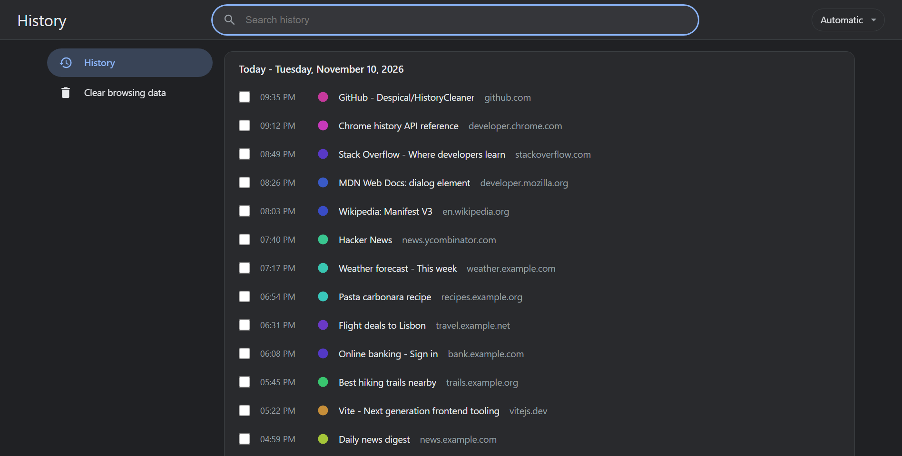
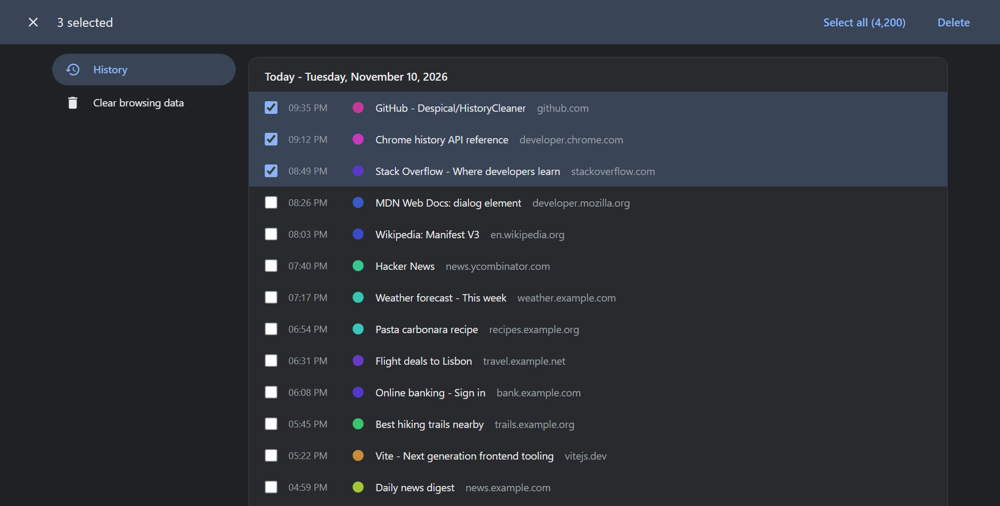

<p align="center">
  
</p>

<h1 align="center">History Cleaner</h1>

<p align="center">A Chrome history page that deletes thousands of entries in small batches, without freezing or failing.</p>

<p align="center">
  
  
  
  
  <a href="https://github.com/Despical/HistoryCleaner/actions/workflows/ci.yaml"></a>
  <a href="LICENSE"></a>
</p>

<p align="center"><a href="#installation">Installation</a> · <a href="#usage">Usage</a> · <a href="#how-it-works">How it works</a></p>

<p align="center">
  
  
</p>

<p align="center"><sub>Screenshots use sample data, not real browsing history.</sub></p>

---

## The problem

Select a few thousand entries on `chrome://history`, press **Delete**, and Chrome gives up: the request is too large, nothing is removed and the page stays as it was.

History Cleaner replaces that page with one that sends the deletions in small asynchronous batches, shows progress and lets you stop at any time.

## Features

- Deletes any number of entries in batches of 50, so the page never freezes and the request never times out.
- Progress dialog with a **Stop** button.
- `Ctrl+A` selects every entry in the result list, not just the rendered rows. Shift-click selects a range.
- `Delete` opens the confirmation dialog whenever something is selected.
- Search narrows the list first, so "select all" can remove one site, one topic or everything.
- Layout modeled on Chrome's own history page: day cards, a selection bar, a row menu and the confirmation dialog.
- Follows the browser's light and dark theme.
- English and Turkish with an in-page language picker.
- No network access, no analytics and no data leaves the browser.

## Installation

The extension is not on the Chrome Web Store yet. Install it unpacked:

1. Download the latest `history-cleaner-v*.zip` from the [releases page](https://github.com/Despical/HistoryCleaner/releases) and extract it, or clone this repository and use the `src` folder.
2. Open `chrome://extensions` and turn on **Developer mode**.
3. Click **Load unpacked** and choose the extracted folder (or `src`).
4. Press `Ctrl+H`. The new history page replaces Chrome's.

Works in other Chromium browsers (Edge, Brave, Opera) as long as they allow extensions to replace the history page.

## Usage

| Action | How |
| --- | --- |
| Select one entry | Click the row or its checkbox. |
| Select a range | Click one entry, then Shift-click another. |
| Select everything in the list | `Ctrl+A`, or **Select all** in the selection bar. |
| Delete the selection | **Delete** in the selection bar, or the `Delete` key. |
| Delete a single entry | Row menu (⋮) → **Remove from history**. |
| Stop a running deletion | **Stop** in the progress dialog. Entries already removed stay removed. |
| Change the language | Dropdown at the right of the search bar. |

Deleting an entry removes every visit of that address, the same as Chrome's own history page.

## How it works

The extension overrides the `history` page through `chrome_url_overrides`. It loads results with `chrome.history.search`, keeps the selection in memory and removes entries with `chrome.history.deleteUrl`, fifty at a time. Rows are rendered 300 at a time while you scroll, so large histories stay responsive.

Permissions: `history` to read and delete entries and `favicon` to show site icons. Nothing else is requested.

## Languages

The page follows the browser language and falls back to English. Pick a language manually with the dropdown. To add one, add a block to `STRINGS` and an entry to `LANGS` in [`src/i18n.js`](src/i18n.js). The extension name and description in `chrome://extensions` stay English. `npm run validate` checks that every language has the same keys.

## Development

```sh
npm install
npm run validate   # manifest, files, syntax and language keys
npm run icons      # regenerate PNG icons from assets/history-cleaner-icon.svg
```

Load `src/` as an unpacked extension and reload it from `chrome://extensions` after each change. See [CONTRIBUTING.md](CONTRIBUTING.md).

## Privacy

History Cleaner runs entirely inside your browser. It does not make network requests, collect analytics or send your history anywhere.

## Security and conduct

Report vulnerabilities privately as described in [SECURITY.md](SECURITY.md). Participation is governed by the [Code of Conduct](CODE_OF_CONDUCT.md).

## License

History Cleaner is free software released under the [GNU General Public License v3.0](LICENSE).
